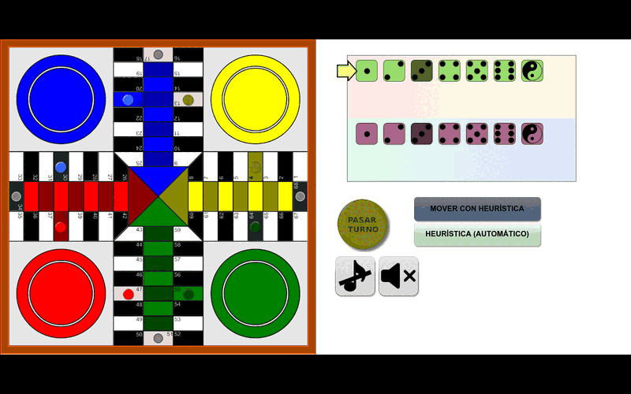
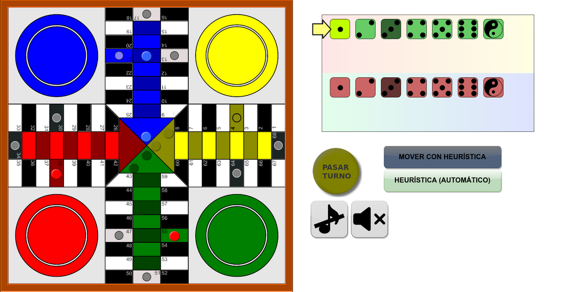

# 🎲 IA para el Parchís con Minimax y poda alfa-beta


Un **agente que juega al Parchís** con algoritmos de búsqueda con adversario: **Minimax**, **poda alfa-beta**, **profundidad dinámica** y **ordenación de movimientos**. Para valorar las posiciones usa una **heurística propia** que tiene en cuenta el avance de las fichas, las amenazas, las barreras y las capturas.

Es la Práctica 3 de *Inteligencia Artificial* del Grado en Ingeniería Informática de la **Universidad de Granada** (curso 2024/2025).

<p align="center">
  
  <br>
  <em>Partida completa a cámara rápida: mi IA (amarillo y verde) contra la IA de referencia (azul y rojo).</em>
</p>

---

## 📌 Mi aportación

El profesorado proporciona el **motor del juego**: reglas, interfaz gráfica en SFML, modo en red y contador de nodos. Lo que hice yo es el **jugador automático**, es decir, el código que decide qué ficha mover y con qué dado:

| Fichero | Contenido |
|---|---|
| [`src/personal/AIPlayer.cpp`](src/personal/AIPlayer.cpp) | Algoritmos de búsqueda y heurística |
| [`src/personal/AIPlayer.h`](src/personal/AIPlayer.h) | Declaración del agente y de las heurísticas |
| [`speed.sh`](speed.sh) | Script que lanza en paralelo partidas contra los bots del servidor de la asignatura |

## 🎯 El problema

Se juega una variante del Parchís **para dos jugadores**. Cada jugador controla **dos colores**, y además de los dados normales hay **dados especiales** con objetos y efectos. Las reglas de comer ficha, formar barreras, rebotar en la meta y llegar a casa son las del Parchís clásico.

En cada turno el agente debe elegir la mejor combinación de **(color, ficha, dado)** con una limitación importante: puede generar como máximo **3,5 millones de nodos por movimiento**. Por eso hace falta tanto una búsqueda eficiente como una buena función de evaluación.

## 🧠 Cómo funciona

### Algoritmos de búsqueda

Implementé varias versiones de la búsqueda con adversario, cada una mejorando a la anterior:

| Algoritmo | Idea |
|---|---|
| **Minimax** | Explora el árbol de jugadas alternando nodos MAX (yo) y MIN (rival) hasta una profundidad fija. |
| **Minimax limitado** | Igual, pero se detiene de forma segura al llegar al límite de nodos y se queda con la mejor jugada encontrada hasta ese momento. |
| **Poda alfa-beta** | Descarta las ramas que no pueden mejorar el resultado, lo que permite buscar hasta **profundidad 8**. |
| **Profundidad dinámica** | Ajusta la profundidad según el **factor de ramificación**: profundiza más cuando hay pocas jugadas posibles (≤ 4: +2; ≤ 8: +1) y recorta cuando hay muchas (≥ 12: −1; ≥ 20: −2). |
| **Ordenación de movimientos** | En los primeros niveles del árbol ordena los hijos por su valor heurístico (de mayor a menor en MAX y al revés en MIN). Así la poda alfa-beta descarta más ramas antes. |

El agente admite varias configuraciones, que se eligen con su `id`:

| `id` | Configuración |
|:---:|---|
| `0` | Poda alfa-beta + `Heuristica1` (**versión final**) |
| `1` | Profundidad dinámica + heurística de prueba (`ValoracionTest`) |
| `2` | Alfa-beta con ordenación de movimientos + `Heuristica1` |

### Heurística (`Heuristica1`)

La valoración de una posición es **mi puntuación menos la del rival**, y las dos se calculan de la misma forma:

| Factor | Efecto |
|---|---|
| 🏁 **Avance** | Penaliza la distancia que le queda a cada ficha hasta la meta. |
| 🛡️ **Seguridad** | +1 por cada ficha en una casilla segura y +5 por cada ficha en la meta. |
| 🏠 **Fichas en casa** | −2 por cada ficha que todavía no ha salido. |
| ⚔️ **Amenazas** | Penaliza las fichas propias que tienen fichas rivales detrás a poca distancia, porque pueden ser comidas. |
| 🧱 **Barreras** | Penaliza las barreras rivales en el camino hacia la meta, más cuanto más cerca estén (en un rango de 25 casillas). Las barreras propias que estorban a mis fichas se penalizan menos. |
| 🍽️ **Capturas** | ±30 si un jugador come una ficha del otro. Si un jugador se come una ficha propia (lo que permiten las reglas), la valoración tiene en cuenta lo avanzada que estaba esa ficha. |
| 🏆 **Victoria o derrota** | Devuelve ±∞ para que el agente siempre prefiera ganar y evite perder. |

## 📊 Resultados

Partidas sin interfaz gráfica de mi versión final (`id 0`) contra la IA de referencia (`id 1`), jugando una vez con cada color:

| Partida | Mi IA juega con | Turnos | Resultado | Tiempo medio por movimiento | Nodos medios por movimiento |
|---|---|:---:|:---:|:---:|:---:|
| 1 | Amarillo y verde (J1) | 54 | ✅ **Victoria** | 21,6 s | 681.099 |
| 2 | Azul y rojo (J2) | 72 | ✅ **Victoria** | 26,2 s | 915.888 |

Ninguna jugada superó el límite de 3,5 millones de nodos.

Durante el curso también evalué el agente contra los bots *ninja* del servidor de la asignatura con [`speed.sh`](speed.sh).

<p align="center">
  
</p>

## 🚀 Compilación y ejecución

**Requisitos (Linux):** `g++` con C++17, `cmake` y [SFML](https://www.sfml-dev.org/).

```bash
git clone https://github.com/joseaguilaar/practica3.git
cd practica3
./install.sh      # instala SFML (apt) y compila
```

Si ya tienes SFML instalado:

```bash
cmake -DCMAKE_BUILD_TYPE=Release . && make -j
```

Ejemplos de uso:

```bash
# Interfaz gráfica: mi IA contra la de referencia
./ParchisGame --p1 AI 0 MiIA --p2 AI 1 Referencia

# Sin interfaz gráfica (más rápido)
./ParchisGame --p1 AI 0 MiIA --p2 AI 1 Referencia --no-gui

# Jugar tú contra la IA
./ParchisGame --p1 GUI 0 Humano --p2 AI 0 MiIA
```

> Compila en modo `Release`: la búsqueda es mucho más rápida que en `Debug`, que es el modo que usa `install.sh`.

## 📁 Estructura del repositorio

```
.
├── src/personal/        ← mi implementación (AIPlayer: búsqueda + heurística)
├── src/ · include/      motor del juego: modelo, GUI (SFML) y red
├── data/                texturas, fuentes, shaders y sonidos
├── config/              direcciones del servidor de la asignatura
├── docs/img/            capturas y GIF de este README
├── speed.sh             partidas en paralelo contra los ninjas
├── CMakeLists.txt
└── install.sh
```

## 🛠️ Lo que trabajé en esta práctica

- **Búsqueda con adversario**: Minimax, poda alfa-beta y sus mejoras (profundidad dinámica y ordenación de movimientos).
- Diseño y ajuste de **funciones heurísticas** para un juego con azar y muchas reglas.
- Optimización con un **presupuesto de cómputo limitado** (nodos por jugada).
- Trabajo sobre una **base de código C++ grande y ajena** (`Parchis`, `ParchisBros`, `Heuristic`), extendiéndola sin modificar el motor.
- Automatización de pruebas con **scripts de Bash** que lanzan partidas en paralelo.

## 🙏 Créditos

El motor del juego, la interfaz gráfica y el enunciado son del profesorado del Departamento de Ciencias de la Computación e Inteligencia Artificial (DECSAI) de la Universidad de Granada, con licencia [MIT](LICENSE). El jugador automático de `src/personal/` es mío.

---

<p align="center">Hecho por <a href="https://github.com/joseaguilaar">@joseaguilaar</a></p>
